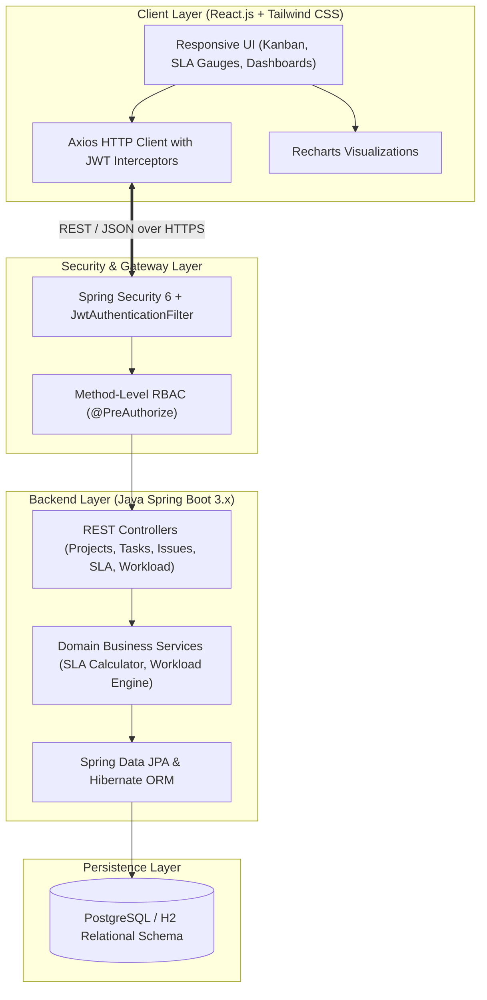

# Enterprise Project & Service Management Platform


An enterprise-grade Java full-stack web application combining **Project Portfolio & Kanban Task Management** (Jira-style) with **IT Service Desk, Real-Time SLA Monitoring & Workload Balancing** (ServiceNow-style) into a single, unified business platform.

---

## 🌟 Key Capabilities

- **📋 Project & Milestone Governance:** Track project health (`ON_TRACK`, `AT_RISK`, `DELAYED`) with automated completion percentages calculated from linked deliverables.
- **📌 Interactive Kanban Task Board:** Drag-and-drop workflow (`BACKLOG` $\to$ `TO DO` $\to$ `IN PROGRESS` $\to$ `REVIEW` $\to$ `DONE`), task priority ranking, effort estimation, and dependencies.
- **🎫 Service Desk & Ticket Management:** Full ticketing lifecycle for internal service requests and technical issues with severity categorization and resolution histories.
- **⏱️ Automated SLA Countdown Engine:** Real-time response and resolution timers with automatic warning alerts at 75% threshold and breach escalation logging.
- **👥 Resource & Workload Matrix:** Real-time visibility into developer utilization percentages, weekly capacity allocations, and automated burnout/overload alerts.
- **🔒 Enterprise Security & RBAC:** Stateless JWT authentication, BCrypt password encryption, and Role-Based Access Control across 5 personas: *Admin, Project Manager, Team Lead, Team Member, and Service Agent*.
- **📊 Executive KPI Dashboard:** Interactive charts (Recharts) for project health, issue distribution, SLA compliance trends, and CSV/Excel audit exports.

---

## 🏗️ System Architecture



---

## 📂 Project Structure

```text
TASK-APP-PRJ_INTERNSHIP-JAVA/
├── 📁 backend/                        # Java Spring Boot 3 REST API
│   ├── 📁 src/main/java/com/epsm/     # Domain controllers, services, entities, security
│   ├── 📁 src/main/resources/         # application.yml, schema migrations
│   └── 📄 pom.xml                     # Maven dependencies
│
├── 📁 frontend/                       # React.js Single Page Application
│   ├── 📁 src/components/             # Kanban board, SLA timers, Workload matrix
│   ├── 📁 src/pages/                  # Projects, Tasks, Tickets, Dashboard
│   ├── 📁 src/services/               # Axios API clients
│   └── 📄 package.json                # Dependencies and scripts
│
└── 📁 docs/                           # Documentation & Specifications
    ├── 📄 ROADMAP_20_DAYS.md          # 20-Day 5% daily progress blueprint
    └── 📄 ARCHITECTURE.md             # System technical specifications
```

---

## 🚀 Getting Started

### Prerequisites
- **Java Development Kit (JDK 17+)**
- **Maven 3.8+**
- **Node.js (v18+) & npm**
- **PostgreSQL 15+** (or embedded H2 for quick start)

### Quick Run

1. **Backend (Spring Boot):**
   ```bash
   cd backend
   mvn spring-boot:run
   ```
   *Runs at `http://localhost:8080` (API Docs at `/swagger-ui/index.html`)*

2. **Frontend (React + Vite):**
   ```bash
   cd frontend
   npm install
   npm run dev
   ```
   *Runs at `http://localhost:5173`*

---

## 📜 Daily Progress Plan (5% Daily)
See [docs/ROADMAP_20_DAYS.md](file:///c:/Users/yraj3/Desktop/TASK%20APP%20PRJ_INTERSHIP%20JAVA/docs/ROADMAP_20_DAYS.md) for the complete 20-day delivery roadmap.
