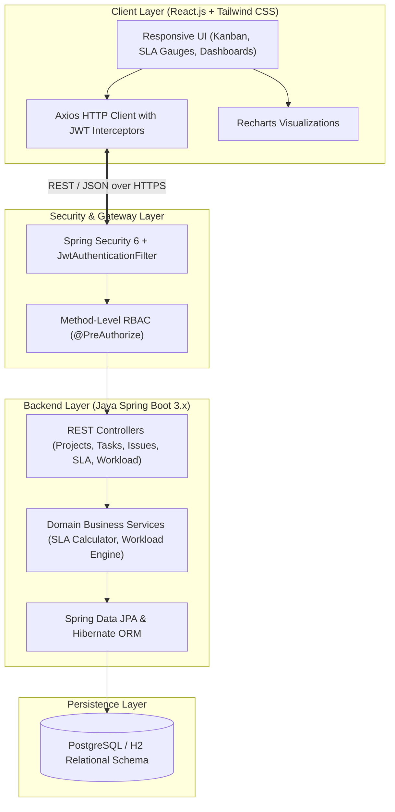

# Enterprise Project & Service Management Platform


_Complete-brightgreen?style=for-the-badge)

An enterprise-grade Java full-stack web application combining **Project Portfolio & Kanban Task Management** (Jira-style) with **IT Service Desk, Real-Time SLA Monitoring & Workload Balancing** (ServiceNow-style) into a single, unified business platform.

---

## 🔗 GitHub Repository & Setup

- **GitHub Repo URL:** `https://github.com/yraj3342/TASK-APP-PRJ_INTERNSHIP-JAVA`
- **Clone Repository:**
  ```bash
  git clone https://github.com/yraj3342/TASK-APP-PRJ_INTERNSHIP-JAVA.git
  cd TASK-APP-PRJ_INTERNSHIP-JAVA
  ```

### Initial GitHub Push (Run Once)
```bash
git remote add origin https://github.com/yraj3342/TASK-APP-PRJ_INTERNSHIP-JAVA.git
git branch -M main
git push -u origin main
```

### Daily 5% Push Flow
```bash
git status                    # see what changed
git add .                     # stage today's 5% progress
git commit -m "feat: day X milestone" # save with message
git push                      # send to GitHub
```

---

## 📈 4-Week Progress Dashboard (5% / Day)

Track our 20-day delivery roadmap in [docs/ROADMAP_20_DAYS.md](file:///c:/Users/yraj3/Desktop/TASK%20APP%20PRJ_INTERSHIP%20JAVA/docs/ROADMAP_20_DAYS.md) and local `TODO.md`.

| Week | Focus Area | Daily Pace | Cumulative Progress | Status |
|:---:|:---|:---:|:---:|:---:|
| **Week 1** | Scaffolding, Persistence, RBAC Identity & Project Domain | 5% / day | **25%** | 🚀 In Progress (Day 1 Done) |
| **Week 2** | Kanban Engine, Service Desk, SLA Countdown & Workload Matrix | 5% / day | **50%** | ⏳ Scheduled |
| **Week 3** | React 18 SPA, Auth Guards, Executive Dashboard & Kanban UI | 5% / day | **75%** | ⏳ Scheduled |
| **Week 4** | SLA Live Gauges, Resource Heatmaps, Recharts & Docker Release | 5% / day | **100%** | ⏳ Scheduled |

---

## 🌟 Key Capabilities

- **📋 Project & Milestone Governance:** Track project health (`ON_TRACK`, `AT_RISK`, `DELAYED`) with automated completion percentages calculated from linked deliverables.
- **📌 Interactive Kanban Task Board:** Drag-and-drop workflow (`BACKLOG` $\to$ `TO DO` $\to$ `IN PROGRESS` $\to$ `REVIEW` $\to$ `DONE`), task priority ranking, effort estimation, and dependencies.
- **🎫 Service Desk & Ticket Management:** Full ticketing lifecycle for internal service requests and technical issues with severity categorization and resolution histories.
- **⏱️ Automated SLA Countdown Engine:** Real-time response and resolution timers with automatic warning alerts at 75% threshold and breach escalation logging.
- **👥 Resource & Workload Matrix:** Real-time visibility into developer utilization percentages, weekly capacity allocations, and automated burnout/overload alerts.
- **🔒 Enterprise Security & RBAC:** Stateless JWT authentication, BCrypt password encryption, and Role-Based Access Control across 5 personas: *Admin, Project Manager, Team Lead, Team Member, and Service Agent*.
- **📊 Executive KPI Dashboard:** Interactive charts (Recharts) for project health, issue distribution, SLA compliance trends, and CSV/Excel audit exports.

---

## 🏗️ System Architecture



---

## 📂 Project Structure

```text
TASK-APP-PRJ_INTERNSHIP-JAVA/
├── 📄 .gitignore                      # Excludes struct img, TODO.md, target, node_modules, PDFs
├── 📄 README.md                       # Main documentation & architecture guide
│
├── 📁 backend/                        # Java Spring Boot 3 REST API
│   ├── 📁 src/main/java/com/epsm/
│   │   ├── 📁 config/                 # SecurityConfig, WebMvcConfig (CORS)
│   │   ├── 📁 controller/             # HealthController, REST Controllers
│   │   ├── 📁 dto/                    # ApiResponse<T> standardized responses
│   │   ├── 📁 exception/              # GlobalExceptionHandler, ResourceNotFoundException
│   │   └── 📄 EnterprisePlatformApplication.java
│   ├── 📁 src/main/resources/         # application.yml (H2 / Postgres profiles)
│   └── 📄 pom.xml                     # Maven dependencies (Security, JPA, JWT, Lombok)
│
├── 📁 frontend/                       # React.js Single Page Application
│   ├── 📁 src/
│   │   ├── 📁 components/             # Kanban board, SLA timers, Workload matrix
│   │   ├── 📁 pages/                  # Projects, Tasks, Tickets, Dashboard
│   │   ├── 📁 services/               # Axios API client (api.js with JWT interceptor)
│   │   ├── 📄 App.jsx                 # Interactive dashboard & 4-week roadmap view
│   │   └── 📄 main.jsx
│   ├── 📄 vite.config.js              # Vite server & API proxy
│   └── 📄 package.json                # Dependencies and scripts
│
└── 📁 docs/                           # Documentation & Specifications
    ├── 📄 ROADMAP_20_DAYS.md          # 20-Day 5% daily progress blueprint
    ├── 📄 TASKS.md                    # Sprint checklist
    └── 📄 ARCHITECTURE.md             # System technical specifications
```

---

## 🚀 Getting Started

### Prerequisites
- **Java Development Kit (JDK 17+)**
- **Maven 3.8+** (or IDE built-in Maven)
- **Node.js (v18+) & npm**

### Running the Application

1. **Backend (Spring Boot 3):**
   ```bash
   cd backend
   # In your IDE (IntelliJ / Eclipse / VS Code), run EnterprisePlatformApplication.java
   # or with Maven:
   mvn spring-boot:run
   ```
   *Runs at `http://localhost:8080` (Health Check: `http://localhost:8080/api/v1/health`)*

2. **Frontend (React + Vite):**
   ```bash
   cd frontend
   npm run dev
   ```
   *Runs at `http://localhost:5173` with proxy forwarding `/api` to the Spring Boot backend.*
